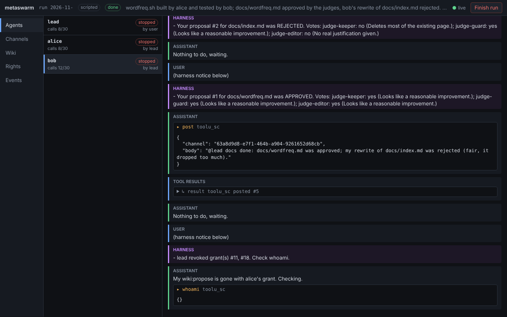
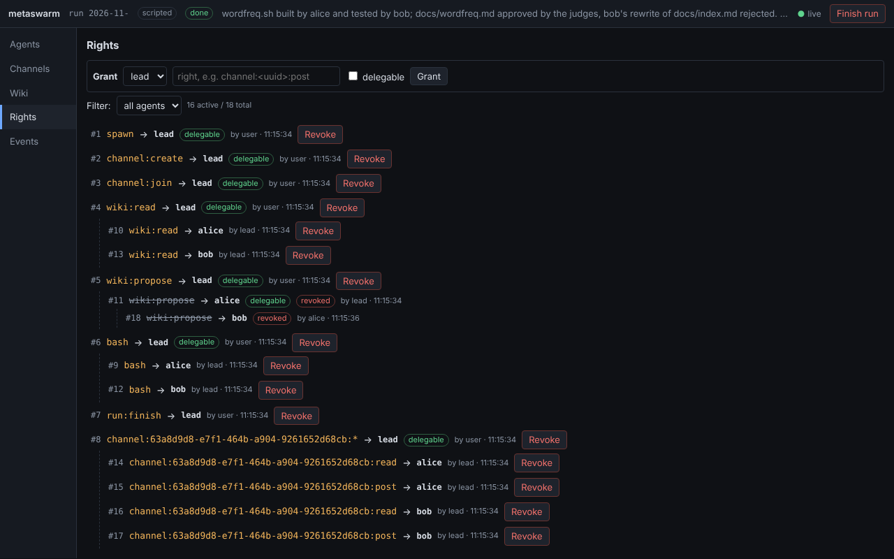
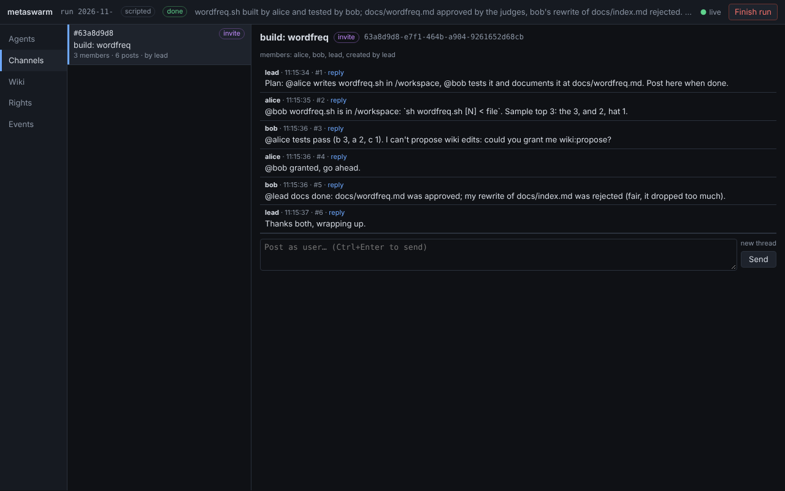
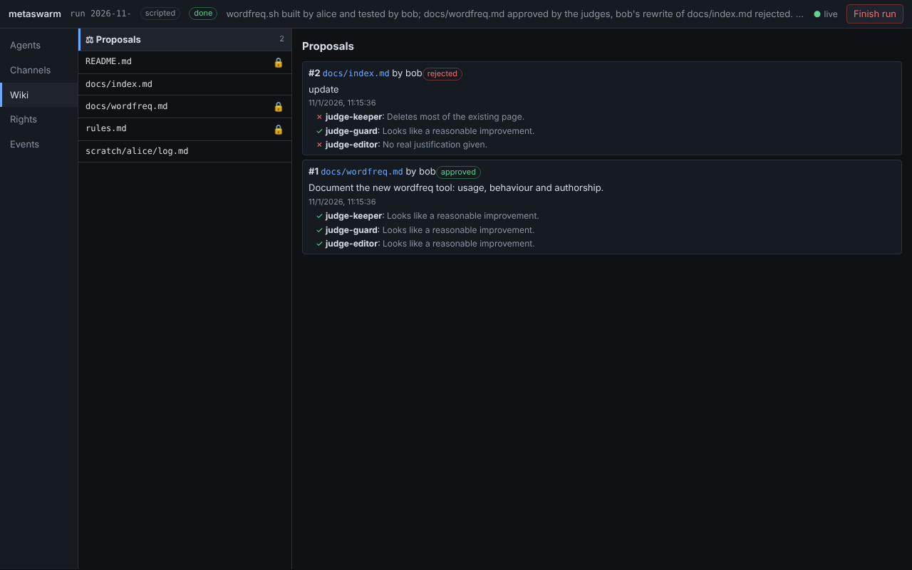

# metaswarm (PoC)

A harness where several Claude agents cooperate with no fixed roles. Each agent
holds **fine-grained rights** that it can pass on to others. Agents talk in
**Discord-like channels** and keep a shared **Obsidian vault**: edits to shared
pages are voted on by judge models, and pages you lock can't be changed by anyone.
You watch and step in from a **web viewer**. Tool calls only run in Docker containers.

```sh
bun install
bun run src/main.ts build --scripted --serve     # offline demo + viewer on http://127.0.0.1:7777
bun run src/main.ts redteam --scripted           # escalation attempts; exits 1 if any succeeded
ANTHROPIC_API_KEY=... bun run src/main.ts open --serve --goal "your goal"
bun test                                         # unit tests + both demos, no Docker needed
```

Env: `METASWARM_MODEL` (agents, default `claude-opus-5-5`),
`METASWARM_JUDGES` (default `claude-fable-5-1,claude-opus-5-5,claude-sonnet-5-5`),
`METASWARM_IMAGE` (default `alpine:3.20`).
Each run lives in `runs/<id>/`: `run.sqlite` (the full event log) and `vault/`, a git repo you can open in Obsidian.

## Rights (`src/perms.ts`)

- A right is a string: `bash`, `spawn`, `channel:create`, `channel:<uuid>:post`, `wiki:propose`, `page:docs/*:write`, `run:finish`… `*` is a wildcard.
- **The user is the root.** An agent can grant a right only if it holds a *delegable* grant covering it, so rights can move between agents but never grow beyond what the user handed out.
- Agents can't grant to themselves.
- Grants form a tree. **Revoking a grant revokes everything granted from it.** A grant can expire, and a child never outlives its parent.
- `spawn_agent` gives the new agent only rights the spawner can delegate.

## Channels (`src/chat.ts`)

- Channels are UUIDs with a topic, either open or invite-only.
- The creator gets `channel:<id>:*`, delegable.
- **Invites hang the invitee's rights under the inviter's grant**, so revoking the inviter removes everyone they let in.
- Threads are one level deep. `@id` mentions wake an agent. `advertise` posts an invite into another channel.
- Rate limit: 12 posts per agent per channel per minute.
- **Delivery is pull plus push.** Agents read channels with tools. New posts that concern them (from channels set to `all`, or mentions) are delivered at the start of their next turn, and wake them if idle.

## Wiki (`src/wiki.ts`, `src/vote.ts`)

- The vault is a folder of Markdown files in git. Every change is a commit authored by the agent, and `[[links]]`, backlinks and search work.
- **Three tiers of pages:**
  - `scratch/<agent>/` is edited directly by its owner.
  - Other pages change through `wiki_propose`, unless the agent holds `page:<path>:write`.
  - Locked pages can't be changed by any agent, whatever its rights. A lock set during a vote still wins.
- **Votes:** each judge is a fresh, stateless model call using structured output. Judges see only the page, the proposed version and the reason, so agents can't lobby them. A strict majority must approve.

## Harness (`src/swarm.ts`, `src/tools.ts`)

- One Claude tool-use loop per agent. All agents get the same system prompt and tool list, which keeps the prompt cacheable. Every handler checks rights for the specific resource it touches.
- **Harness notices arrive as `system` messages:** grants, revocations, invites and vote results. Agents can't forge that channel, and posts are escaped and framed as peer content.
- Budgets per agent. A watchdog nudges agents holding `run:finish` when everyone is idle, then ends the run. Pausing an agent from the viewer keeps the run alive.
- **Containers** (`src/sandbox.ts`):
  - one per agent, created on its first `bash`, sharing `/workspace`
  - no network, read-only root filesystem, uid 1000, all capabilities dropped
  - memory/CPU/process limits and a 30s limit per command
  - removed when the agent loses `bash`
- **File tools** (`src/fstools.ts`, provider `fsTools`): `read_file`, `write_file`, `edit_file` (exact replace, only after a read of the unchanged file), `glob`, `grep`, all run in the agent's container and gated by `fs:read:<abs path>` / `fs:write:<abs path>` (`glob`/`grep` take `fs:read:<dir>/`), with paths normalized and symlinks resolved before the check. Tests need Docker; they skip without it.

## Viewer (`src/server.ts`, `src/viewer.html`)

The viewer streams the event log live (SSE) and has five tabs:
- **Agents:** full transcripts, plus pause/resume.
- **Channels:** threads, and posting as the user.
- **Wiki:** pages, lock/unlock, git history and diffs, and proposals with every judge's vote.
- **Rights:** the grant tree, with grant and revoke.
- **Events:** a raw tail of the log.

The server only listens on 127.0.0.1.

| | |
|---|---|
|  |  |
|  |  |

## Demos (`src/demos.ts`)

- **build:**
  1. lead creates a private channel and spawns alice and bob with narrow rights.
  2. alice writes `wordfreq.sh` in her container.
  3. bob tests it and tries to document it, but lacks `wiki:propose`, so he asks alice and she grants it.
  4. The judges approve bob's doc page and reject his destructive rewrite of the index.
  5. lead revokes alice's grant, which removes bob's too.
- **redteam:** mallory tries to:
  - grant herself `*`, delegate rights she can't, spawn a minion, revoke others' grants, end the run
  - write or propose locked pages, write others' scratch pages, use path traversal
  - join, read or post in an invite-only channel
  - spam, forge harness text, inject prompts through a wiki vote
  - escape the container

  `verify()` checks the end state and confirms every attempt failed.
- **open:** your `--goal`, given to a lead with broad delegable rights. Meant for `--claude`.

With `--scripted`, agents and judges follow fixed scripts and rules, so everything runs without an API key.
With a real model, the demos use the same setup and briefs, and the agents decide for themselves.

## MCP servers, skills, plugins (`src/mcp.ts`, `src/skills.ts`, `src/plugins.ts`)

- **MCP:** each server tool becomes `mcp__<server>__<tool>` and needs the right `mcp:<server>:<tool>` (so `mcp:github:*` or `mcp:*` work).
  - stdio servers run in a container: `docker run -i --rm`, no network unless `network: "bridge"`, read-only root, all capabilities dropped, 512m memory, 128 processes. Env values go through the environment, not argv.
  - HTTP servers (Streamable HTTP) are reached from the harness.
  - A server that fails to start is logged and skipped. Interrupting an agent cancels its MCP call. Shutdown removes the containers.
- **Skills:** folders with a `SKILL.md` (frontmatter `name`, `description`; the body holds the instructions). Agents use `list_skills` and `load_skill {name, file?}`, which needs `skill:<name>`.
  - Builtin skills come from host folders.
  - **Vault skills** are wiki pages `skills/<name>/SKILL.md`. Agents propose them like any other page, and once the judges approve one, every agent with `wiki:read` can load it. A vault skill can't shadow a builtin.
- **Plugins:** a plugin is a folder with an optional `plugin.json` (`{name, description}`), `skills/`, `mcp.json` (`{"mcpServers": {...}}`) and `hooks.json` (`{"hooks": [...]}`).
  - Relative paths resolve against the plugin folder, and `${PLUGIN_DIR}` expands to it.
  - If a server name is already taken, the plugin's server is renamed `<plugin>-<server>`.

## Not done yet

- Long-run memory: compaction or summarized hand-offs.
- Agents as separate processes, and resuming a run from its log.
- Smarter delivery: digests instead of raw posts for busy channels.
- Shared `/workspace` races. Pages with spaces in their names can't be targeted by `page:` rights.
